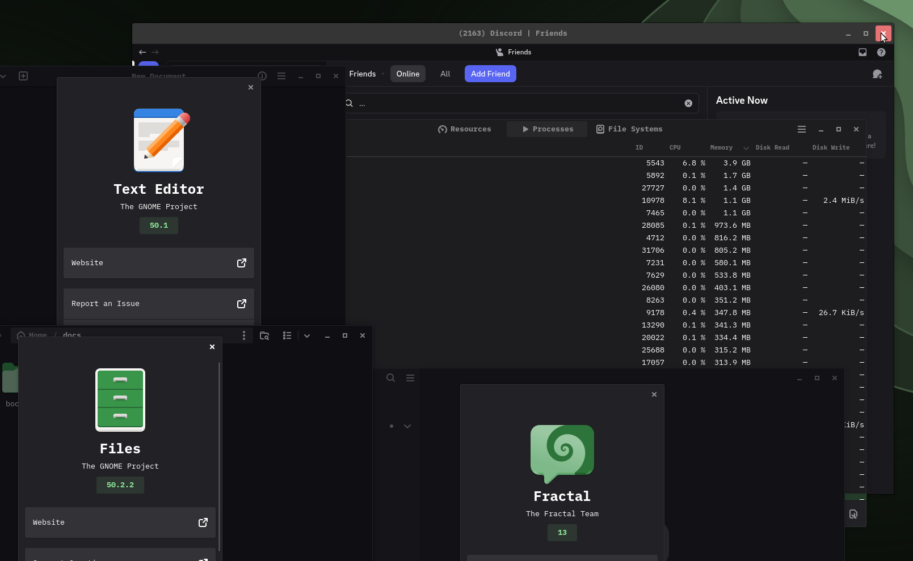
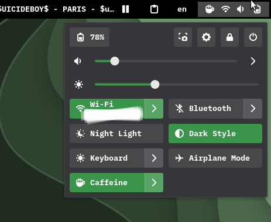
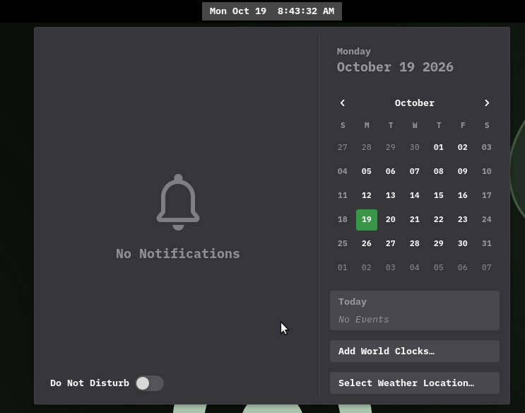
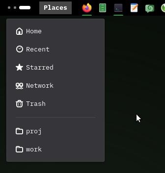
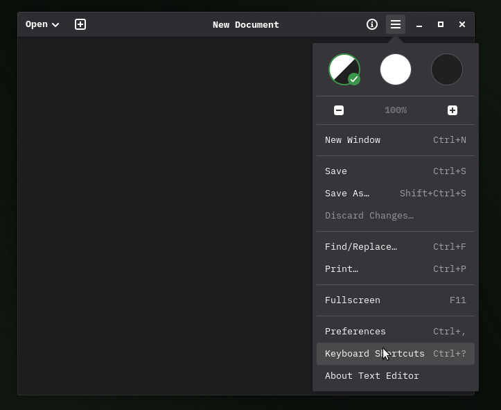

# dotfiles

[eng](README.md)

Настройка рабочего стола GNOME 48: тема shell MyShell, стили GTK 3/4 и
расширения GNOME Shell с настройками. Темная схема.

## Скриншоты



| Быстрые настройки | Календарь и уведомления |
| --- | --- |
|  |  |

| Меню Places | Меню Text Editor |
| --- | --- |
|  |  |

## Установка

Выполни в терминале:

```sh
git clone https://github.com/U1F974/dotfiles.git ~/dotfiles
~/dotfiles/install.sh
```

> Совет: `./install.sh` принимает такие опции:

```
-s, --shell           Тема shell MyShell, включается через User Themes

-g, --gtk             Стили GTK 3/4 в ~/.config/gtk-{3.0,4.0},
                      тема GTK 3 Adwaita-dark с цветом акцента
                      в ~/.local/share/themes, тема иконок Adwaita-Void
                      в ~/.local/share/icons

-e, --extensions      Расширения GNOME Shell и их настройки

-F, --firefox         Кнопки окна Firefox и LibreWolf (userChrome.css)
                      и цвет акцента (user.js) в их профилях по умолчанию

-d, --dest DIR        Папка для темы shell
                      (по умолчанию: ~/.local/share/themes);
                      User Themes читает еще ~/.themes и /usr/share/themes

-f, --user-theme-fix  Заодно поставить исправленный User Themes (только GNOME 48)

-u, --uninstall       Удалить ссылки на репозиторий, вернуть самые свежие
                      бэкапы (расширения не удаляются)

-h, --help            Показать справку
```

Без `-s`, `-g`, `-e` и `-F` ставятся все четыре части. Например, `./install.sh -s -g`
ставит только тему shell и стили GTK. Про `-f` см.
[исправление User Themes](#исправление-user-themes-только-gnome-48).

> Подробнее: `./install.sh --help`

`home/` повторяет домашнюю папку, его файлы ставятся симлинками:

- Тема shell: `~/.local/share/themes/MyShell`, включается через расширение
  User Themes.
- Стили GTK: `~/.config/gtk-3.0` и `~/.config/gtk-4.0`; темная Adwaita для
  GTK 3 с цветом акцента: `~/.local/share/themes/Adwaita-dark`; иконки в
  цвет акцента: `~/.local/share/icons/Adwaita-Void`.
- Firefox и LibreWolf: `firefox/` повторяет папку профиля и ставится в
  профиль, которым пользуется каждый браузер (`[Install*] Default=` в
  `profiles.ini`, иначе профиль с `Default=1`). Профили ищутся в
  `~/.config/mozilla/firefox` или `~/.mozilla/firefox` и в
  `~/.config/librewolf/librewolf` или `~/.librewolf`.
- Файл, который уже лежит на месте, сохраняется с меткой времени (`*.bak`);
  копия, совпадающая с репозиторием, заменяется без бэкапа.
- Расширения скачиваются, включаются и получают свои настройки (см. ниже).

Правки в репозитории применяются сразу; запускать `install.sh` снова нужно
только после добавления файлов. Чтобы увидеть изменения, перезапусти
GTK-приложения; для новых расширений нужно выйти из сеанса и зайти снова. Не
перемещай и не удаляй репозиторий: ссылки ведут в него.

Перезагрузить тему shell вручную (на Wayland Alt+F2 `r` не работает):

```sh
gsettings set org.gnome.shell.extensions.user-theme name '' &&
gsettings set org.gnome.shell.extensions.user-theme name 'MyShell'
```

## Структура

```
home/                                     повторяет ~, install.sh ставит симлинки
  .local/share/themes/MyShell/gnome-shell/  тема shell
    accent.css                                сгенерирован, подключается из gnome-shell.css
  .local/share/themes/Adwaita-dark/gtk-3.0/ сгенерированная темная Adwaita для GTK 3 с акцентом
  .local/share/icons/Adwaita-Void/          сгенерированная тема иконок в цвет акцента
  .config/gtk-4.0/gtk.css                   ручные правки GTK 4
  .config/gtk-4.0/radius.css                сгенерирован, подключается из gtk.css
  .config/gtk-3.0/gtk.css, radius.css       то же для GTK 3
tools/gen-radius.py                       генератор radius.css
tools/gen-accent.py                       генератор файлов цвета акцента
gnome-extensions/                         список расширений, настройки (dconf),
                                          скрипты
  local/                                    расширения, которые лежат в этом репозитории
extras/user-theme-fix/                    исправление утечки в User Themes (GNOME 48)
firefox/                                  повторяет профиль Firefox/LibreWolf:
  chrome/userChrome.css                     кнопки окна
  user.js                                   включает чтение userChrome.css, цвет акцента
screenshots/                              картинки для этого README
```

## Тема MyShell и GTK

Компактный "квадратный" вид по мотивам
[Fluent GTK theme](https://github.com/vinceliuice/Fluent-gtk-theme)
(стандартные скругления, компактные заголовки окон). Тему GTK это не
заменяет: тема shell подключает стандартную `gnome-shell-dark.css` и
переопределяет ее, GTK-часть это пользовательский CSS поверх
Adwaita/libadwaita. У каждого измененного значения в CSS есть комментарий со
стандартным.

Свой цвет акцента вместо девяти из Настроек, см.
[Цвет акцента](#цвет-акцента).

GNOME Shell (`home/.local/share/themes/MyShell/gnome-shell/gnome-shell.css`):
- Скругление 3px почти везде: кнопки панели, быстрые настройки, меню,
  календарь, уведомления, OSD, Alt+Tab. Крупные элементы как во Fluent:
  диалоги 6px, плитки обзора 9px, док 15px.
- Быстрые настройки примерно на четверть плотнее: сетка, высота кнопок, поля.
- Дни календаря скругленные квадраты, ячейки чуть меньше.
- Переключатели примерно на четверть меньше.

GTK 4 / libadwaita (`home/.config/gtk-4.0/`) и GTK 3 (`home/.config/gtk-3.0/`):
- Заголовки окон 36px вместо 47px, кнопки и поля ввода в них 28px.
- Кнопки окна квадраты 28px со скруглением; при наведении серые,
  "закрыть" красная.
- Скругление 3px у окон, меню, кнопок, полей, списков, карточек.
  Переключатели, ползунки, аватары и другие круглые элементы остаются круглыми.

### radius.css

Пользовательский CSS в GTK по приоритету выше темы. Простое
`button { border-radius: 3px }` перебило бы и правила темы, которые обнуляют
углы на стыках склеенных кнопок или держат круглые кнопки круглыми.
Поэтому `tools/gen-radius.py` копирует все правила со скруглениями из
встроенного CSS libadwaita и GTK 3 Adwaita, сохраняет селекторы и их порядок
и меняет только значения. После обновления libadwaita или GTK:

```sh
tools/gen-radius.py
```

### Цвет акцента

В Настройках только девять цветов акцента. Здесь везде, где виден акцент,
используется свой цвет, сейчас зеленый из логотипа Void Linux (`#478061`).
Чтобы его сменить:

```sh
tools/gen-accent.py '#rrggbb'
./install.sh -g
gsettings set org.gnome.shell.extensions.user-theme name '' &&
gsettings set org.gnome.shell.extensions.user-theme name 'MyShell'
gnome-extensions disable accent@dots && gnome-extensions enable accent@dots
gsettings set org.gnome.desktop.interface icon-theme 'Adwaita' &&
gsettings set org.gnome.desktop.interface icon-theme 'Adwaita-Void'
```

Скрипт записывает цвет в `gtk.css` и `firefox/user.js` и генерирует файлы из
списка ниже. `./install.sh -g` ставит ссылки на новые файлы, следующие
строки перезагружают тему shell, стиль для расширений и иконки. Затем
перезапусти GTK-приложения, Firefox и LibreWolf. В Настройках выбери
ближайший из девяти: приложения, которые читают акцент через портал
настроек, по-прежнему получают его. Текст на акценте везде белый, поэтому
скрипт предупреждает, если контраст ниже 3:1, то есть хуже любого цвета из
Настроек (светлые акценты).

После обновления GNOME Shell, расширений или GTK 3 запусти
`tools/gen-accent.py` без цвета: он пересоберет файлы с текущим.

Куда попадает акцент:
- GTK 4 / libadwaita: `--accent-bg-color` в `gtk.css`, единственное место,
  где хранится цвет (скрипт читает его оттуда). Более светлый цвет для
  текста и ссылок libadwaita выводит из него сама.
- Shell: тема получает акцент как `-st-accent-color` и переопределить его не
  может. Скрипт копирует все объявления с ним из стандартной
  `gnome-shell-dark.css` в `accent.css` и подставляет наш цвет.
- Другие расширения (точки запущенных приложений Dash in Panel и т. п.):
  стили расширений перебивают тему shell при любом селекторе, их может
  перебить только стиль другого расширения. Скрипт копирует их правила с
  акцентом с `!important` в стиль расширения Accent for extensions
  (`gnome-extensions/local/accent@dots`).
- GTK 3: встроенная Adwaita акцент не учитывает, в темном варианте у нее
  зашит синий (`#15539e`) и заранее посчитанные оттенки. Скрипт пишет полную
  копию этого CSS, где каждый оттенок синего заменен таким же оттенком
  нашего цвета, как тему `Adwaita-dark` в `~/.local/share/themes`. GTK 3 ищет
  темы там раньше, чем в `/usr/share/themes`, поэтому настройка gtk-theme
  остается `Adwaita-dark`. Копия только измененных правил в `gtk.css` не
  подходит: пользовательский CSS перебивает тему при любом селекторе и
  перебил бы и другие состояния (неактивная основная кнопка осталась бы
  цвета акцента).
- Firefox и LibreWolf берут акцент, выделение текста и выбранные пункты из
  акцента Настроек через портал настроек. `ui.accentcolor`, `ui.highlight` и
  `ui.selecteditem` (с парами `*text`) в `firefox/user.js` их заменяют.
- Иконки: иконки папок и некоторых приложений следуют акценту через Accent
  Icons, а у него есть темы иконок только на девять цветов из Настроек.
  Скрипт копирует его зеленую тему (сделана из `#3a944a`), заменяя каждый
  оттенок таким же оттенком нашего цвета, как тему иконок `Adwaita-Void`.
  Accent Icons использует ее для любого акцента
  (`gnome-extensions/settings/accent-directories.ini`). Приложения, которых
  у него нет (LibreWolf, Code - OSS; `APP_ICONS` в скрипте), получают свою
  PNG-иконку, перекрашенную скриптом: такие иконки состоят из основного
  цвета, белого и их смесей, и каждая смесь сохраняет долю с нашим цветом.

### Особенности приложений

- Nautilus: строка пути и поиск лежат в одном стеке, высоту заголовка задает
  самая высокая страница; обе ужаты до 28px. Его собственные скругления 3px.
- Заголовок и полоса вкладок в одном `AdwToolbarView` (Nautilus и др.)
  оборачиваются в `.collapse-spacing` с отступом 3px, даже когда вкладка одна.
  Отступ убран.
- Ptyxis добавляет 3px над заголовком, когда открыто несколько вкладок; убрано.
- Двухстрочные заголовки (Text Editor, Ptyxis): `line-height: 0.8`, чтобы
  влезть в 28px.
- Кнопка с аватаром (переключатель аккаунтов Fractal) и вкладки
  переключателя видов (System Monitor) были выше 28px и растягивали заголовок
  и кнопки окна; обе подогнаны под 28px.
- Chromium в режиме темы GTK рисует кнопки окна по стилям GTK 4. У его кнопок
  нет класса `.image-button`, а у его заголовка есть `.header-bar`, которого
  нет у настоящих GTK 4 заголовков; правила учитывают оба случая. Размер
  кнопок там задает сам Chromium (40px в полосе вкладок 46px).
- Electron-приложения с системным заголовком (Vesktop) рисуют кнопки окна по
  стилям GTK 3; `--gtk-version=4` их не переключает. Adwaita рисует наведение
  на кнопку GTK 3 градиентом `background-image`, который закрывает
  `background-color`, поэтому правила кнопок окна его убирают. Заголовок у
  них по стилю `headerbar.default-decoration` (37px, кнопки 28px); промежуток
  между кнопками у Chromium равен константе 6px плюс margin, поэтому правило
  для `windowcontrols` (в GTK 3 этот узел есть только у Chromium) сдвигает
  кнопки на 3px ближе.
- Firefox и LibreWolf рисуют кнопки окна своим CSS, а не через GTK:
  `firefox/chrome/userChrome.css` делает их такими же квадратами 28px со
  скруглением. Для этого нужна настройка
  `toolkit.legacyUserProfileCustomizations.stylesheets` из `firefox/user.js`.
  После правок перезапусти браузер.
- Telegram с системной рамкой на Wayland получает ее от Qt-плагина
  `libadwaita.so`, который сам рисует круглые кнопки и CSS не читает;
  оставлено как есть. VS Code рисует заголовок сам, его это не касается. К
  значкам трея в Quick Settings (см. ниже) это отношения не имеет.

## Расширения GNOME Shell

| Расширение | Зачем | Что изменено в настройках |
|---|---|---|
| [Accent Icons](https://extensions.gnome.org/extension/7535/accent-directories/) | иконки папок в цвет акцента | тема `Adwaita-Void` для любого акцента |
| [Add to Desktop](https://extensions.gnome.org/extension/3240/add-to-desktop/) | "добавить на рабочий стол" в меню сетки приложений | по умолчанию |
| [AppGrid Fit](https://extensions.gnome.org/extension/9933/app-grid-icon-size/) | размер сетки приложений | 12 столбцов x 6 строк, без пресетов, страницы не объединяются |
| [Caffeine](https://extensions.gnome.org/extension/517/caffeine/) | не гасить экран | переключение из командной строки включено |
| [Clipboard Indicator](https://extensions.gnome.org/extension/779/clipboard-indicator/) | история буфера обмена | 20 записей |
| [Dash in Panel](https://extensions.gnome.org/extension/7855/dash-in-panel/) | значки приложений на панели | кнопка Activities видна; кнопка сетки приложений, док в обзоре и обзор при входе выключены |
| [Gtk4 Desktop Icons NG (DING)](https://extensions.gnome.org/extension/5263/gtk4-desktop-icons-ng-ding/) | значки на рабочем столе | по умолчанию |
| [Just Perfection](https://extensions.gnome.org/extension/3843/just-perfection/) | тонкая настройка shell | по умолчанию |
| [Media Controls](https://extensions.gnome.org/extension/4470/media-controls/) | плеер на панели | справа, фиксированная ширина подписи 200px, без кнопок "назад", "вперед" и перемотки, без ползунка трека |
| [Top Bar Organizer](https://extensions.gnome.org/extension/4356/top-bar-organizer/) | порядок элементов панели | см. `settings/top-bar-organizer.ini` |
| [Gradia Capture](https://github.com/AlexanderVanhee/gradia-companion) | скриншоты через Gradia | цвета инструментов разметки; ставится приложением Gradia, на extensions.gnome.org его нет |
| [Auto Move Windows](https://gitlab.gnome.org/GNOME/gnome-shell-extensions) | приложения на свои рабочие столы | по умолчанию |
| [Removable Drive Menu](https://gitlab.gnome.org/GNOME/gnome-shell-extensions) | подключенные диски на панели | по умолчанию |
| [Places Status Indicator](https://gitlab.gnome.org/GNOME/gnome-shell-extensions) | меню "Места" на панели | по умолчанию |
| [User Themes](https://gitlab.gnome.org/GNOME/gnome-shell-extensions) | загружает тему MyShell | тема `MyShell` |
| Tray Quick Settings (`gnome-extensions/local`) | значки трея приложений в Quick Settings | свое расширение, настроек нет |
| Accent for extensions (`gnome-extensions/local`) | цвет акцента в других расширениях, см. [Цвет акцента](#цвет-акцента) | свое расширение, настроек нет |

Четыре расширения перед двумя последними идут в пакете дистрибутива
`gnome-shell-extensions`. Двух последних нет на extensions.gnome.org:
исходники лежат в `gnome-extensions/local/`, а `install.sh` делает на них
симлинки в `~/.local/share/gnome-shell/extensions`.

**Tray Quick Settings** (`tray-quick-settings@dots`) показывает значки трея
приложений отдельным рядом внизу Quick Settings. Левый клик выполняет действие
приложения, средний клик и колесо передаются приложению, правый клик
открывает меню приложения поверх Quick Settings. Приложение, которому нужно
внимание, показывает свой значок на панели слева от Quick Settings; заглушенные
чаты Telegram и приложения, которые показывают непрочитанное только в
картинке (Vesktop), не показывают. Расширение само держит трей, поэтому не
работает вместе с AppIndicator (имя трея на шине занимает тот, кто запустился
первым). Загружается после следующего входа в систему.

- `gnome-extensions/extensions.tsv`: uuid, источник (`ego`, `package`, `app`,
  `local`) и путь в dconf для каждого расширения.
- `gnome-extensions/settings/*.ini`: `dconf dump` измененных настроек.
- `gnome-extensions/install.sh`: скачивает недостающие расширения `ego` под
  текущую версию GNOME, делает симлинки на расширения `local` из репозитория
  (существующая копия сохраняется как `.bak`), загружает настройки и
  добавляет все расширения из списка в `enabled-extensions`.
- `gnome-extensions/dump.sh`: выгружает текущие настройки обратно в
  репозиторий; запускай после изменения настроек расширений.

## Исправление User Themes (только GNOME 48)

`disable()` в User Themes 48 вызывает `disconnectObject()` без отслеживаемого
объекта, и подписка на настройки не снимается. Shell выключает расширения при
блокировке экрана, поэтому каждая разблокировка добавляет подписку, и одна
смена темы перезагружает ее N раз. `extras/user-theme-fix/install.sh` кладет
исправленную копию в `~/.local/share/gnome-shell/extensions`; она загрузится
после следующего входа.

После обновления GNOME эту копию удали: в ней указан только shell 48, и когда
она перестанет загружаться, она все равно будет перекрывать системное
расширение.

## Удаление

```sh
~/dotfiles/install.sh -u
```

Возвращает User Themes к стандартной теме, удаляет ссылки на репозиторий
(тема shell, `gtk.css`/`radius.css` в `~/.config/gtk-*`, `userChrome.css` и
`user.js` в Firefox и LibreWolf) и возвращает самый
свежий `*.bak` каждого. Файлы, которые не ссылаются на репозиторий, не
трогает.
Расширения не удаляются: `gnome-extensions uninstall <uuid>`.
